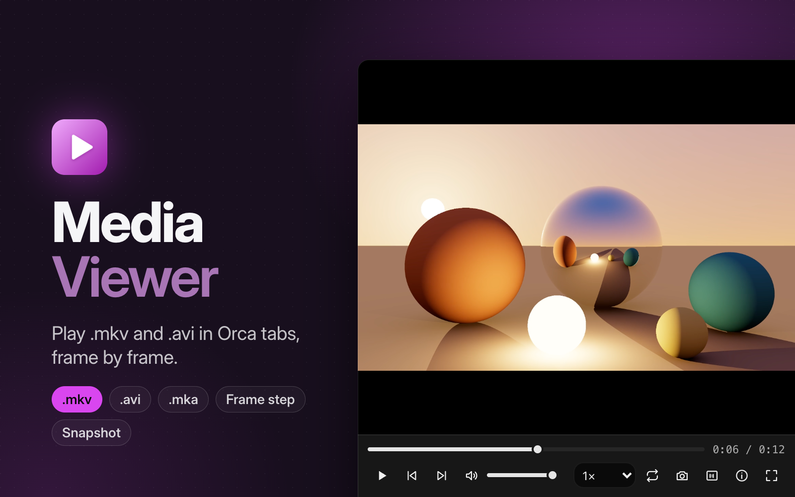

# Media Viewer for Orca



Video and audio in [Orca](https://orca.dev)'s editor tabs — opened from the file tree, a file
link in an agent chat, or `orca file open`, just like images.

| Files                                                        | What opens                                                                                                                      |
| ------------------------------------------------------------ | ------------------------------------------------------------------------------------------------------------------------------- |
| `.mkv`, `.avi`, `.mka`, `.weba`                              | **Media Player** — Orca has no viewer for these and shows "Binary file — cannot display" without the plugin.                    |
| `.mp4`, `.m4v`, `.mov`, `.webm`, `.mp3`, `.wav`, `.m4a`, `.aac`, `.ogg`, `.oga`, `.flac`, `.opus` | Orca's own basic player (any size) by default; switch the tab to **Media Player** with the view toggle at the top right of the tab. |

Media Player adds:

- speed from 0.25× to 3×, repeat, frame-by-frame stepping, fit / actual size;
- **save the current frame as PNG** through Orca's save dialog;
- file info: size, duration and type, and for video the resolution and frame rate (the AVI
  decoder's own, otherwise measured over a second of playback at 1×);
- keyboard shortcuts, Orca's light and dark themes, English and Russian UI;
- a cover instead of a black frame for audio;
- a notice when part of a file cannot play: a video codec that Orca's Chromium does not decode
  (the sound still plays), or sound it does not decode (the picture still plays);
- **AVI** — Xvid, DivX, MPEG-4, H.264, MJPEG, MPEG-1/2 video with MP3, AC3, AAC or PCM sound (see below).

**Icons.** The plugin adds the file icon theme **Media Viewer**: pick it in Orca → Settings →
Appearance → Icon theme, and `.mp4`, `.mov`, `.mkv`, `.mp3`, `.flac` and other media get a video or
an audio icon in tabs, the file tree, Quick Open and search, also when Orca's own player opens them.
It maps only media files: Orca has one icon theme at a time, so other files show Orca's built-in
icons while it is selected.

It is read-only and offline: no capabilities, no network, the file is never modified.

**Size limit.** Orca sends a plugin editor at most 50 MiB of `.mkv`, `.avi`, `.mka` or `.weba`,
and at most 64 MiB of `.mp4`, `.m4v`, `.mov`, `.webm` or audio; for larger files it shows its own
notice. For `.mp4`, `.mov`, `.webm` and audio, Orca's built-in player has no limit, so switch the
tab back to it.

## Keyboard

| Key                   | Action                              |
| --------------------- | ----------------------------------- |
| `Space` / `K`         | Play / pause                        |
| `←` `→`               | Back / forward 5 s (`Shift`: 1 s)   |
| `J` `L`               | Back / forward 10 s                 |
| `,` `.`               | Previous / next frame               |
| `0`–`9`               | Jump to 0 %–90 %                    |
| `Home` `End`          | Start / end                         |
| `<` `>` / `=`         | Slower / faster / normal speed      |
| `↑` `↓` / `M`         | Volume / mute                       |
| `R`                   | Repeat                              |
| `S`                   | Save frame as PNG                   |
| `Z`                   | Fit to window / actual size         |
| `I`                   | File info                           |

Letter keys follow the key's place on the keyboard, so they also work with a Russian or another
non-Latin layout.

## Formats

Playback uses the Chromium inside Orca. H.264, VP8, VP9 and AV1 video and AAC, MP3, Opus,
Vorbis, FLAC and PCM audio play everywhere; HEVC (H.265) plays where the OS has a hardware
decoder (macOS, recent Windows). ProRes, and MPEG-2 or MPEG-4 Part 2 (Xvid, DivX) outside AVI, do
not play: a file with such video plays its sound only, and a notice names the video codec. AC3,
E-AC3, DTS and TrueHD sound does not play: when a file has no other sound track, the picture plays
without sound and a notice says so.

**AVI.** Chromium cannot play `.avi`, so Media Player converts it to MP4 when the tab opens,
inside the tab and offline: FFmpeg built to WebAssembly (`vendor/ffmpeg`, about 2 MB) decodes
it, and the browser's own encoders (WebCodecs: H.264 in hardware where the system has it, else
VP9; Opus or AAC sound) write the MP4 that the player then plays. It takes a moment, shown as
"Preparing AVI for playback… N %"; a few hundred milliseconds for a short clip, longer for a
long one. Video: Xvid, DivX 3/4/5, MPEG-4 Part 2, H.264, H.263, MJPEG, MPEG-1/2, raw. Sound: MP3,
MP2, AC3, AAC, PCM, IMA/MS ADPCM; surround is mixed down to stereo. An AVI with another video
codec (for example WMV or Indeo) shows which codec it is. Sound in another codec (WMA, DTS, FLAC,
Vorbis, G.711) is dropped: the video plays without sound and a notice names the sound codec;
damaged sound in a codec it has plays the same way, with a notice that it could not be decoded.
Convert such files with `ffmpeg -i in.avi -c:v libx264 -c:a aac out.mp4`. Orca's 50 MiB limit for
`.avi` applies.

## Known limits

- **Anamorphic AVI** (non-square pixels, such as a 720 × 576 PAL rip flagged 16:9) plays with
  square pixels, so the picture is too narrow: the conversion keeps the stored frame size.
- **AVI colours.** The decoder does not pass on a stream's colour description. SD video (under
  720 lines) in a codec that has none (Xvid, DivX and other MPEG-4 Part 2, DivX 3, H.263, MJPEG,
  MPEG-1, raw) is tagged BT.601; H.264 and MPEG-2, which can have one, and all HD video are tagged
  BT.709. A file that differs from that rule, such as SD H.264 made for BT.601, plays with
  slightly shifted colours.
- **AVI errors.** The decoder reports one error for "codec not built in" and "stream does not
  open". Media Player calls the file damaged when the codec is one it has (Xvid, DivX, H.264,
  MJPEG …); a damaged header that names some other codec reads as that codec being unsupported.
- **Frame rate in file info** is measured during playback at 1× for everything but AVI, and
  shows "—" until about a second has played; at other speeds it is not measured.
- **Frame steps** use the frame duration the container declares (Matroska, WebM, MP4, MOV) or the
  AVI decoder's rate. A file that declares none, such as some browser recordings, steps at 30 fps
  until a second of playback at 1× has measured its rate.
- **Files without a duration** (MediaRecorder WebM, piped or unfinished recordings): when the
  file opens, the player seeks to 1 s, which gives Chromium the duration of a piped MKV, and only
  when that does not, seeks past the end, so Chromium reads the whole file to find it.

## Install

From the catalog: Orca → Settings → Plugins → ⋯ → **Catalog sources…** → add
`https://github.com/Sergei-Popov/orca-plugin.git`, then install **Media Viewer**.

From source:

```sh
git clone https://github.com/Sergei-Popov/orca-media-viewer.git
orca plugin dev load ./orca-media-viewer   # prints the access it needs and an --approve fingerprint
```

## Develop

No build step: Orca transpiles the TypeScript in `src/` on load.

```sh
orca plugin dev watch . --check   # load, reload on save, stream logs
orca plugin test .                # unit tests (src/*.test.ts)
orca plugin types .               # Orca's type declarations in .orca/types, which tsconfig.json uses
npx -y -p typescript@5.9.3 tsc -p .   # type check
orca plugin validate .
orca plugin shot local.media-viewer --editor path/to/clip.mkv   # PNG of the editor
```

- `src/editor.ts` — the custom editor entry: bytes document → Blob → player.
- `src/player.ts` — the player UI; `src/styles.ts`, `src/icons.ts`, `src/i18n.ts`.
- `src/format.ts` — pure helpers (types, MIME, time, units, keys) with tests in `src/format.test.ts`.
- `src/container.ts` — reads Matroska/WebM, MP4/MOV and AVI headers: tracks, codecs, frame
  duration (tests in `src/container.test.ts`, which build the files byte by byte).
- `src/rate.ts` — frame-rate measurement and frame-step targets (`src/rate.test.ts`).
- `src/duration.ts` — finds the duration of a file that declares none (`src/duration.test.ts`).
- `src/avi/` — AVI → MP4: `convert.ts` (editor side), `worker.ts` (Web Worker: decoder,
  WebCodecs, MP4 muxer), `plan.ts` and `messages.ts` (pure choices and texts, tested in
  `src/avi-plan.test.ts`).
- `wasm/avi.c`, `wasm/build.sh` — the AVI decoder on top of FFmpeg 7.1.1; `wasm/build.sh` builds
  `vendor/ffmpeg/avi-decoder.{mjs,wasm}` in Docker (`emscripten/emsdk:3.1.74`), see
  `vendor/ffmpeg/BUILD-INFO`.
- `vendor/mp4-muxer/` — [mp4-muxer](https://github.com/Vanilagy/mp4-muxer) 5.2.1 (MIT).
- `tools/` — the listing images: `make-listing-samples.sh` renders a demo clip
  (`make-listing-clip.py`) into `.orca/listing/samples/`, `listing.json` is the spec for the hub's
  `scripts/listing-image.sh`, `rasterize-icons.sh` turns `images/icon.svg` into the icon.

Branches follow git-flow: `feature/*` from `develop`, releases through `release/x.y.z` into
`main`, tagged `vX.Y.Z`. Only the maintainers push and open pull requests.

---

**По-русски.** Тема значков **Media Viewer** (Настройки → Внешний вид → Тема значков) даёт
медиафайлам свои значки во вкладках и в дереве файлов; остальные файлы при ней показываются
встроенными значками Orca. Видео и аудио во вкладках Orca — из дерева файлов, по ссылке из чата агента или
через `orca file open`, как картинки. `.mkv`, `.avi`, `.mka`, `.weba` открываются плеером сразу
(AVI при открытии конвертируется в MP4 прямо во вкладке, без сети: Xvid, DivX, H.264, MJPEG,
MPEG-1/2 со звуком MP3, AC3, AAC, PCM); для
`.mp4`, `.mov`, `.webm`, `.mp3`, `.flac` и других Orca по умолчанию показывает свой простой
плеер, а **Media Player** включается переключателем вида справа вверху вкладки. Скорость,
покадровая перемотка, повтор, сохранение кадра в PNG, сведения о файле, горячие клавиши (работают
и в русской раскладке), светлая и тёмная темы. Если видеокодек не поддерживается Chromium в Orca (MPEG-2, Xvid вне AVI,
ProRes), играет только звук, и плеер об этом пишет; если звук в AC3, E-AC3, DTS или TrueHD (в AVI —
WMA, DTS, FLAC и т. п.), видео играет без звука с таким же уведомлением. Лимит Orca для редакторов
плагинов — 50 МиБ для `.mkv`, `.avi`, `.mka`, `.weba` и 64 МиБ для `.mp4`, `.mov`, `.webm` и
аудио.

## License

MIT © Sergei Popov, except:

- `vendor/ffmpeg/` — FFmpeg 7.1.1 from <https://ffmpeg.org>, LGPL-2.1-or-later
  (`vendor/ffmpeg/LICENSE`);
- `wasm/` — the source and build script of `vendor/ffmpeg/`, LGPL-2.1-or-later too
  (`vendor/ffmpeg/LICENSE`);
- `vendor/mp4-muxer/` — MIT (`vendor/mp4-muxer/LICENSE`).
